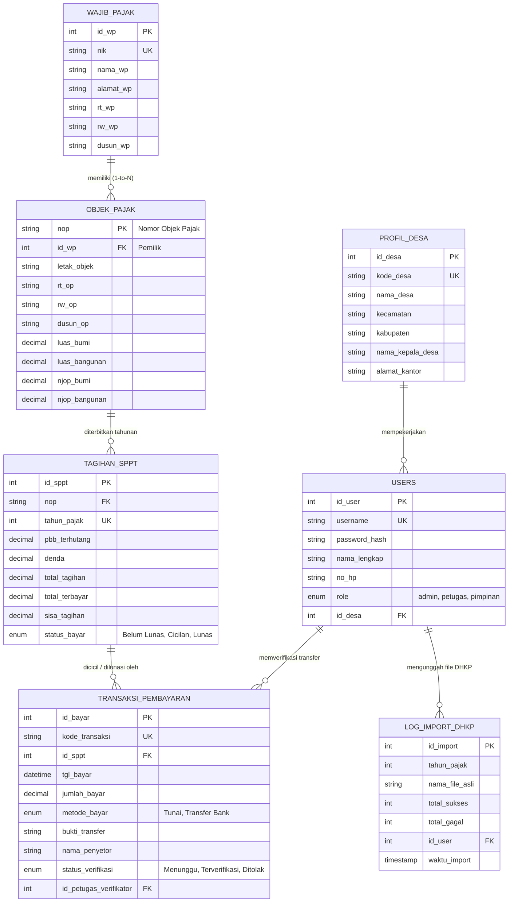

# Spesifikasi Arsitektur Basis Data PBB yang Telah Diperbaiki (3NF + Workflow Lapangan)
### Sistem Informasi Pajak Bumi dan Bangunan (PBB) - Kampung Sidomulyo Punggur

Dokumen ini merupakan hasil penyempurnaan menyeluruh dari kelemahan sistem sebelumnya dan menutup seluruh celah operasional yang ada di lapangan.

---

## 1. Matriks Perbaikan Kekurangan Sistem

| No | Celah Sebelumnya | Solusi Perbaikan yang Diimplementasikan | Implementasi Teknis |
|---|---|---|---|
| 1 | **Beban Input Ribuan Data DHKP** | Penambahan modul dan tabel **Audit Import Massal Excel/CSV DHKP**. | Tabel `log_import_dhkp` untuk merekam riwayat unggah file dari Dispenda, jumlah baris berhasil/gagal, dan user pengunggah. |
| 2 | **Tidak Mendukung Pembayaran Cicilan** | Penambahan skema **Saldo & Akumulasi Pembayaran Cicilan**. | Kolom `total_terbayar`, `sisa_tagihan`, dan status `ENUM('Belum Lunas', 'Cicilan', 'Lunas')` pada `tagihan_sppt`. |
| 3 | **Risiko Bukti Transfer Palsu / Asal Upload** | Penerapan **Approval Workflow (Verifikasi Pembayaran)**. | Kolom `status_verifikasi` (`Menunggu Verifikasi`, `Terverifikasi`, `Ditolak`), `alasan_penolakan`, dan `id_petugas_verifikator`. |
| 4 | **Sistem Tertutup (Warga Harus ke Balai Desa)** | Perancangan **Portal Warga Cek SPPT & Unggah Struk Mandiri**. | Pencarian publik berbasis NOP dengan proteksi validasi 4 digit NIK/Nama dan upload bukti bayar langsung dari HP warga. |
| 5 | **Otomasi Status & Saldo Pembayaran** | Penggunaan **Database Triggers** untuk integritas data waktu-nyata (*real-time*). | 4 Database Triggers otomatis mengupdate `total_terbayar`, `sisa_tagihan`, dan `status_bayar` saat pembayaran diverifikasi. |
| 6 | **Dukungan Peran Kepemimpinan** | Penambahan role pimpinan untuk Kepala Kampung. | Penambahan role `pimpinan` pada tabel `users` untuk monitoring realisasi penerimaan kas PBB tanpa hak merusak data master. |
| 7 | **Privasi Data Kependudukan (UU PDP)** | Aturan *Data Masking* pada tampilan publik. | NIK dan Nomor HP warga disensor pada respon antarmuka publik (contoh: `180204******0001`). |

---

## 2. Diagram Relasi Entitas Mutakhir (ERD 3NF + Approval Workflow)

---

## 3. Kamus Data & Spesifikasi Kunci Eksplisit

### A. Tabel `tagihan_sppt` (Penyempurnaan Cicilan & Saldo)
- **Primary Key:** `id_sppt` (INT AUTO_INCREMENT)
- **Composite Unique Key:** `(nop, tahun_pajak)` (Mencegah duplikasi tagihan objek pajak pada tahun yang sama).
- **Kolom Kunci:**
  - `total_tagihan`: Pokok PBB + SKP + STP + Denda.
  - `total_terbayar`: Jumlah akumulasi seluruh pembayaran yang telah **berstatus 'Terverifikasi'**.
  - `sisa_tagihan`: `total_tagihan - total_terbayar`.
  - `status_bayar`:
    - `Belum Lunas` (jika `total_terbayar = 0`)
    - `Cicilan` (jika `0 < total_terbayar < total_tagihan`)
    - `Lunas` (jika `total_terbayar >= total_tagihan`)

### B. Tabel `transaksi_pembayaran` (Workflow Verifikasi & Audit)
- **Primary Key:** `id_bayar` (INT AUTO_INCREMENT)
- **Unique Key:** `kode_transaksi` (VARCHAR(35)) $\rightarrow$ Format: `BYR-YYYYMMDD-XXXX`.
- **Workflow Verifikasi:**
  - Jika disetor **Tunai** langsung ke loket balai desa $\rightarrow$ status langsung `Terverifikasi`, `id_petugas_verifikator` langsung terisi ID petugas yang melayani.
  - Jika **Transfer Bank** diunggah via portal warga $\rightarrow$ status awal `Menunggu Verifikasi`, `id_petugas_verifikator = NULL`.
  - Petugas loket (Pak Karmin/Admin) memeriksa kesesuaian struk bank dan saldo rekening desa:
    - Jika valid $\rightarrow$ status diubah ke `Terverifikasi` (memicu trigger pengurangan sisa tagihan).
    - Jika palsu/tidak terbaca $\rightarrow$ status diubah ke `Ditolak` dan kolom `alasan_penolakan` diisi.

### C. Tabel `log_import_dhkp` (Otomasi Migrasi Data Dispenda)
- **Primary Key:** `id_import` (INT AUTO_INCREMENT)
- Merekam setiap kali admin melakukan impor spreadsheet DHKP tahunan (.xlsx / .csv).
- Menyimpan jumlah data yang berhasil ditambahkan, jumlah data gagal, dan log error per baris untuk mempermudah perbaikan data.

---

## 4. Mekanisme Keamanan & Privasi Data Publik
Untuk fitur portal cek mandiri warga:
1. **Query Masukan:** Warga memasukkan 18 atau 24 digit **NOP**.
2. **Validasi Tambahan:** Untuk membuka rincian lengkap, sistem meminta konfirmasi 4 digit terakhir NIK atau nama pemilik.
3. **Data Masking pada Output:**
   - NIK: `180204******1234`
   - Nomor HP: `0812****7890`
   - Alamat Kependudukan tetap menampilkan nama Dusun/RT untuk verifikasi tanpa membocorkan dokumen kependudukan lengkap.

---

## 5. Berkas SQL DDL
Seluruh skema di atas beserta 4 Trigger otomatisasi telah dieksekusi dan disimpan pada file:
👉 [database_schema.sql](file:///D:/Perpajakan/database_schema.sql)
