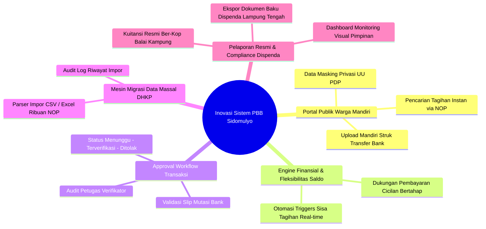
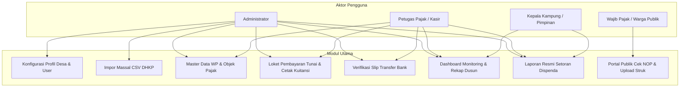
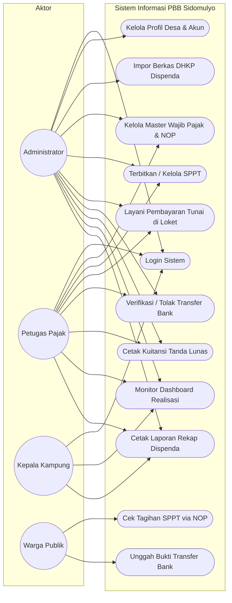
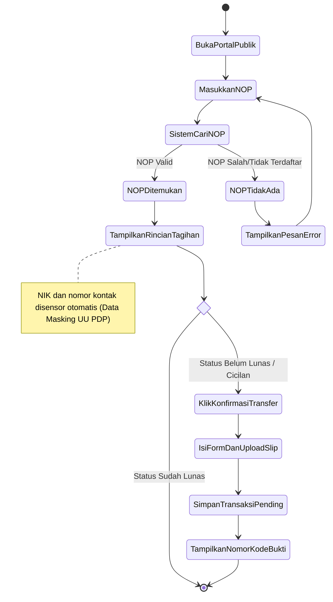
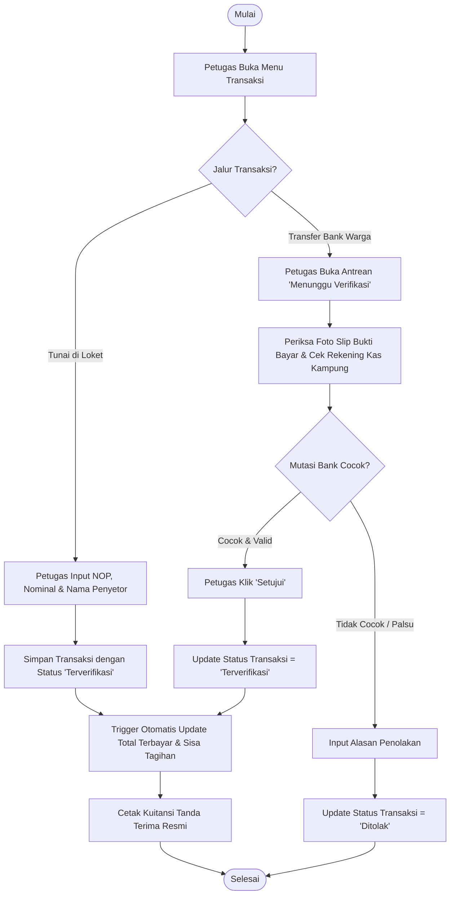
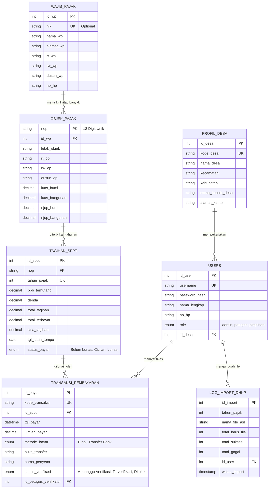
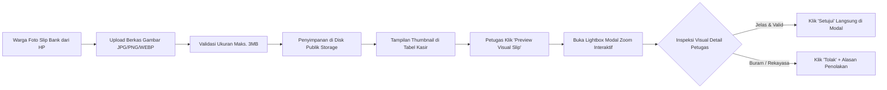

# DOKUMEN CETAK BIRU & PROPOSAL PENGEMBANGAN SISTEM
## SISTEM INFORMASI PAJAK BUMI DAN BANGUNAN (PBB-P2) BERBASIS WEB
### Studi Kasus: Kampung Sidomulyo, Kecamatan Punggur, Kabupaten Lampung Tengah

---

## BAB I: KAJIAN & DEKONSTRUKSI SKRIPSI ACUAN

### 1.1 Identitas Dokumen Referensi
- **Judul Skripsi Acuan:** Rancangan Sistem Informasi Pajak Bumi dan Bangunan Pada Kampung Sidomulyo Punggur Berbasis Web
- **Peneliti / Penulis:** Rangga Alsa Eka Putra (NPM: 19430091)
- **Program Studi:** S1 Ilmu Komputer, Fakultas Ilmu Komputer, Universitas Muhammadiyah Metro (2024)
- **Dosen Pembimbing:**
  1. Dani Anggoro, S.Kom., M.Kom.
  2. Gunayanti K.S Siregar, S.Kom., M.T.I.
- **Narasumber Lapangan:** Bapak Karmin (Pengelola & Petugas Pajak PBB Kampung Sidomulyo Punggur)

### 1.2 Ringkasan Latar Belakang & Realitas Masalah Lapangan
1. **Dua Saluran Pembayaran Pajak:**  
   Warga Kampung Sidomulyo membayar PBB melalui dua jalur: (a) membayar tunai langsung ke petugas balai kampung (Bpk. Karmin), atau (b) transfer melalui bank. Bagi warga yang membayar via bank, mereka tetap harus datang secara fisik membawa slip setoran kertas ke balai desa untuk mengonfirmasi pelunasan.
2. **Pencatatan Manual Buku DHKP (*Daftar Himpunan Ketetapan Pajak*):**  
   Ketika ada warga yang membayar, petugas membuka lembaran tebal dokumen fisik DHKP, mencari nama warga satu per satu di antara ribuan baris, lalu memberi tanda centang/ceklis manual dengan pena.
3. **Kompleksitas Objek Pajak (Fakta Krusial Bab I Hal. 2):**  
   Rata-rata 1 Wajib Pajak (WP) di Kampung Sidomulyo memiliki **lebih dari satu Objek Pajak (NOP)** (misal: rumah tinggal, pekarangan, tanah sawah, atau kebun). Hal ini membuat pencarian dan penandaan manual sangat lambat, rentan tertukar, dan rawan kesalahan catat.
4. **Kewajiban Pelaporan ke Dispenda / Bapenda:**  
   Pihak kampung berkewajiban menyetorkan dan melaporkan rekapitulasi pelunasan PBB ke Dinas Pendapatan Daerah (Dispenda) Kabupaten Lampung Tengah. Proses rekap manual dari buku DHKP kertas memakan waktu berhari-hari.

### 1.3 Rumusan Masalah & Batasan Masalah Awal
- **Rumusan Masalah:** *"Bagaimana cara merancang sistem informasi pajak bumi dan bangunan agar lebih cepat dan efisien pada Kampung Sidomulyo Punggur?"*
- **Batasan Masalah Skripsi Asli:**
  1. Ruang lingkup menu hanya terdiri dari: *Beranda*, *Cek Daftar SPPT*, *Data SPPT*, dan *Laporan*.
  2. Hak akses hanya terbatas untuk: **Admin** dan **Petugas Pajak**.
  3. Menggunakan PHP (OOP), MySQL, XAMPP 7.4.8, Sublime Text/VS Code, metodologi *Waterfall*, serta pengujian *Black Box Testing* dan *Beta Testing*.

---

## BAB II: IDENTIFIKASI KELEMAHAN PENELITIAN SEBELUMNYA

Berdasarkan telaah mendalam terhadap naskah Bab I, Class Diagram (Gambar 14), dan Relasi Tabel fisik `db_pbb2022` (Gambar 15/16), ditemukan sejumlah celah kritis:

| No | Komponen | Kelemahan pada Penelitian Sebelumnya | Dampak Negatif |
|---|---|---|---|
| 1 | **Struktur Entitas Warga** | Tidak ada tabel `wajib_pajak`. Kolom `nama` dan `alamat_wp` disatukan di tabel `data_pbb`. | **Menyalahi fakta lapangan.** Jika 1 warga memiliki 3 bidang tanah (3 NOP), nama dan alamat warga harus diketik ulang 3 kali. Rawan inkonsistensi (*insert & update anomaly*). |
| 2 | **Normalisasi Basis Data (2NF & 3NF)** | Tabel `data_bayar` menduplikasi kolom `nama`, `pajak`, dan `nm_petugas`. | Melanggar 3NF. Perubahan nama petugas atau revisi ketetapan pajak memicu ketidaksinkronan data transaksi. |
| 3 | **Histori Multi-Tahun** | Tidak ada kolom `tahun_pajak`. Nama database di-*hardcode* `db_pbb2022` dengan NOP sebagai PK tunggal. | Database hanya mampu menampung 1 tahun ketetapan. Tidak bisa melacak riwayat tunggakan tahun-tahun lampau dalam satu sistem terpadu. |
| 4 | **Foreign Key & Integritas Relasi** | Terdapat kolom `id_penyetor` dan `id_desa` tanpa adanya tabel master `penyetor` maupun `desa`. | Integritas referensial database (*foreign key constraints*) rusak. |
| 5 | **Sifat Sistem Tertutup** | Hanya dirancang untuk aparatur balai desa. Warga tidak memiliki antarmuka untuk mengecek tagihan secara mandiri. | Warga tetap harus mendatangi balai desa meski sekadar ingin mengetahui nominal tagihan atau menyerahkan struk bank. |
| 6 | **Proses Bisnis Pembayaran Bank** | Tidak ada modul penyimpanan foto slip bukti transfer bank. Status transaksi langsung tercatat tanpa alur verifikasi (*approval workflow*). | Berisiko tinggi terjadi manipulasi struk transfer atau salah catat mutasi bank. |
| 7 | **Skalabilitas Input Data** | Belum memiliki fitur impor massal DHKP (Excel/CSV). | Petugas harus menginput ribuan data NOP dari Dispenda secara manual satu per satu setiap awal tahun anggaran. |

---

## BAB III: ARAH & IDE PENGEMBANGAN SISTEM (NILAI TAMBAH AKADEMIK)

Untuk mempertahankan ide orisinal penelitian (digitalisasi PBB Kampung Sidomulyo) sekaligus mengangkat bobot akademisnya menjadi proyek komputasi tingkat sarjana yang unggul, diusulkan **5 Fitur Nilai Tambah Utama**:



1. **Public Self-Service Citizen Portal & Privacy Masking (UU PDP):**  
   Menyediakan portal publik bagi warga Kampung Sidomulyo untuk memeriksa status SPPT mereka kapan saja dari HP, disertai penyensoran otomatis data sensitif (NIK & kontak) agar mematuhi UU Perlindungan Data Pribadi.
2. **Approval Workflow Verifikasi Transfer Bank:**  
   Menjembatani masalah warga yang bayar lewat bank dengan alur verifikasi resmi: Struk diunggah warga $\rightarrow$ masuk antrean `Menunggu Verifikasi` $\rightarrow$ Petugas memeriksa mutasi kas kampung $\rightarrow$ status disetujui (`Terverifikasi`) atau ditolak dengan catatan alasan.
3. **Flexible Installment Engine (Dukungan Pembayaran Bertahap/Cicilan):**  
   Mengakomodasi realitas warga pedesaan agraris yang seringkali melunasi pajak secara bertahap saat masa panen tiba. Tagihan memiliki status cerdas: `Belum Lunas`, `Cicilan`, dan `Lunas`.
4. **Automated DHKP Bulk Importer:**  
   Mesin pengunggah berkas spreadsheet (CSV/Excel) yang mampu membaca dan memproses ribuan data NOP kiriman Dispenda sekaligus ke database dalam hitungan detik, lengkap dengan pencatatan log audit.
5. **Executive Dashboard & Dispenda Compliance Reporting:**  
   Visualisasi KPI realisasi kas penerimaan (Target Baku vs Realisasi vs Piutang) per dusun, serta format cetak laporan baku yang sesuai standar pertanggungjawaban ke Dispenda Kabupaten Lampung Tengah.

---

## BAB IV: ANALISIS KEBUTUHAN SISTEM

### 4.1 Kebutuhan Fungsional (*Functional Requirements*)
- **FR-01 (Autentikasi & RBAC):** Sistem harus membatasi hak akses berdasarkan peran pengguna (*Administrator*, *Petugas Pajak*, *Kepala Kampung*, dan *Warga Publik*).
- **FR-02 (Manajemen Profil Desa):** Sistem harus mengelola data instansi desa (nama kakam, NIP, alamat, logo) sebagai header kop surat resmi.
- **FR-03 (Manajemen Wajib Pajak):** Sistem harus mampu mencatat master data warga dan mengaitkan satu warga ke banyak objek pajak (relasi *1-to-many*).
- **FR-04 (Manajemen Objek Pajak):** Sistem harus mengelola data fisik tanah/bangunan berbasis NOP 18 digit.
- **FR-05 (Manajemen Ketetapan SPPT):** Sistem harus mampu menerbitkan tagihan tahunan multi-tahun untuk setiap NOP.
- **FR-06 (Impor Massal DHKP):** Sistem harus mampu mengurai (*parsing*) berkas CSV DHKP dan mencatat log audit transaksi impor.
- **FR-07 (Portal Cek Mandiri):** Warga dapat mencari tagihan berdasarkan NOP dengan tampilan NIK tersensor.
- **FR-08 (Konfirmasi Pembayaran Mandiri):** Warga dapat mengunggah bukti foto slip transfer bank ke sistem.
- **FR-09 (Loket Pembayaran Tunai):** Petugas dapat memproses transaksi pembayaran tunai langsung di balai kampung.
- **FR-10 (Workflow Verifikasi Transfer):** Petugas dapat menyetujui atau menolak bukti transfer bank yang diajukan warga.
- **FR-11 (Cetak Kuitansi):** Sistem dapat menghasilkan tanda bukti bayar resmi berformat kuitansi desa.
- **FR-12 (Pelaporan & Rekapitulasi):** Sistem dapat menghasilkan Laporan Realisasi Kas, Laporan Daftar Tunggakan Piutang, dan Rekapitulasi Resmi Dispenda.

### 4.2 Kebutuhan Non-Fungsional (*Non-Functional Requirements*)
- **NFR-01 (Integritas Data & 3NF):** Skema basis data wajib memenuhi kaidah bentuk normal ketiga (3NF) tanpa redundansi kolom non-kunci.
- **NFR-02 (Otomasi Real-time):** Kalkulasi sisa tagihan dan pembaruan status lunas/cicilan wajib ditangani langsung oleh Database Triggers.
- **NFR-03 (Keamanan Akun):** Password petugas wajib di-hash menggunakan algoritma Bcrypt (cost factor 12).
- **NFR-04 (Responsivitas UI):** Antarmuka wajib responsif dan nyaman digunakan baik pada layar komputer kerja maupun smartphone warga.
- **NFR-05 (Print Friendly):** Laporan dan kuitansi wajib memiliki stylesheet khusus cetak (`@media print`) yang menyembunyikan navigasi dan tombol.

---

## BAB V: IDENTIFIKASI AKTOR & MATRIKS HAK AKSES (RBAC)



---

## BAB VI: PEMODELAN SISTEM TERSTRUKTUR (UML & VISUAL DIAGRAMS)

### 6.1 Use Case Diagram



### 6.2 Activity Diagram: Alur Pengecekan Mandiri & Konfirmasi Transfer Bank Warga



### 6.3 Flowchart Sistem: Verifikasi Pembayaran & Pembaruan Saldo Otomatis



---

## BAB VII: PERANCANGAN BASIS DATA TERSTANDARISASI (ERD 3NF)



---

## BAB VIII: PERANCANGAN TEMA VISUAL, IDENTITAS GRAFIS & PENGOLAHAN DOKUMEN GAMBAR

Bab ini secara khusus mendefinisikan aspek estetika visual, pemrosesan berkas gambar digital, visualisasi analitik data, dan penanda grafis keabsahan dokumen dalam sistem.

### 8.1 Identitas Visual & Sistem Desain (*Design System & Color Psychology*)

```
========================================================================
PALET WARNA VISUAL UTAMA (GOVERNMENT EMERALD & HARVEST GOLD SYSTEM)
========================================================================
[ #1b4d3e ] - Primary Forest Green  : Otoritas resmi pemerintahan, kemakmuran pedesaan
[ #133329 ] - Deep Green Dark       : Sidebar & header navigasi yang stabil dan kokoh
[ #c89650 ] - Harvest Accent Gold   : Prestise nilai ketetapan pendapatan kas daerah
[ #f4f6f9 ] - Canvas Soft Neutral   : Latar belakang bersih untuk kenyamanan mata petugas
[ #198754 ] - Semantic Green Lunas  : Indikator visual SPPT Lunas (Bebas Tanggungan)
[ #ffc107 ] - Semantic Yellow Cicil : Indikator visual SPPT Sedang Dicicil
[ #dc3545 ] - Semantic Red Tunggak  : Indikator visual SPPT Menunggak / Butuh Penagihan
========================================================================
```

- **Prinsip Visual:** Antarmuka memadukan kesan **Birokrasi Modern yang Berwibawa** dengan **Aksesibilitas Tinggi untuk Warga Pedesaan**.
- **Tipografi Visual Berjenjang:**
  - *Headings:* Inter / Segoe UI Semi-Bold untuk judul modul yang tegas dan mudah terbaca.
  - *Data Tabular (DHKP):* Monospace & Tabular figures untuk Nomor Objek Pajak (NOP) 18 digit dan nominal rupiah agar kolom tersusun rapi secara visual.
  - *Kuitansi Dokumen:* Serif (Times New Roman) untuk mempertahankan kesan formal akta bukti bayar negara.

---

### 8.2 Visualisasi Data & Diagram Grafis Interaktif (*Interactive Charts*)

Sistem tidak hanya menyajikan angka mentah, melainkan mengonversinya menjadi **komponen grafis visual interaktif** (didukung oleh pustaka `Chart.js`):

1. **Diagram Batang Komparatif Visual (*Grouped Bar Chart*):**  
   - Menampilkan perbandingan berdampingan secara visual antara **Target Baku PBB** (biru) vs **Realisasi Penerimaan Kas** (hijau) per wilayah (Dusun 1, Dusun 2, dan Dusun 3).  
   - Memberikan gambaran visual instan kepada Kepala Kampung mengenai dusun mana yang telah memenuhi target penagihan dan dusun mana yang masih membutuhkan atensi.
2. **Diagram Lingkaran Donut Visual (*Doughnut Chart*):**  
   - Memvisualisasikan proporsi total ketetapan: **% Lunas (Hijau)**, **% Cicilan (Kuning)**, dan **% Belum Lunas (Merah)**.  
   - Dilengkapi *hover tooltip* dinamis yang menampilkan nominal uang dan jumlah lembar SPPT saat kursor diarahkan ke irisan grafik.
3. **Grafik Progress Bar Visual:**  
   - Menampilkan persentase pencapaian total kas desa secara visual dengan indikator warna dinamis (Merah < 40%, Kuning 40-75%, Hijau $\ge$ 75%).

---

### 8.3 Pengolahan Berkas Visual Bukti Transfer Bank (*Image Processing & Lightbox Zoom*)

Untuk menjawab tantangan pembayaran via bank yang rentan bukti palsu atau struk buram:



- **Fitur Lightbox Modal Zoom Visual:**  
  Petugas loket balai desa tidak perlu mengunduh file satu per satu. Sistem menyediakan modal visual terintegrasi dengan tombol:
  - **Perbesar (*Zoom-In*):** Memperbesar resolusi hingga 300% untuk membaca nomor referensi bank dan tanggal mutasi.
  - **Perkecil (*Zoom-Out*) & Reset:** Mengembalikan ukuran tampilan normal.
  - **Inspeksi Berdampingan (*Split View*):** Gambar struk ditampilkan bersisian langsung dengan ringkasan NOP dan nominal tagihan sehingga petugas dapat mencocokkan data dalam satu layar.

---

### 8.4 Elemen Visual Keabsahan Dokumen (QR Code & Stempel Balai Desa)

Kuitansi pembayaran resmi balai desa dilengkapi dua elemen grafis visual keamanan:

1. **Visual Dynamic QR Code:**  
   - Dihasilkan secara otomatis (*real-time vector rendering*) pada pojok kanan atas kuitansi.  
   - Mengarahkan pemindai kamera smartphone langsung ke URL pencarian NOP resmi di portal publik untuk memvalidasi bahwa tanda terima tersebut asli dan tercatat di database desa.
2. **Visual Stempel Resmi Balai Desa (*Digital Seal Stamp*):**  
   - Berupa elemen stempel lingkaran resmi dengan efek *double border*, warna tinta biru formal (*Indigo Blue* `#1a365d`), sudut rotasi -15 derajat, dan teks:  
     `"PEMERINTAH KAMPUNG SIDOMULYO * LUNAS PBB * PUNGGUR"`.  
   - Memberikan kepastian psikologis dan kekuatan hukum visual bagi wajib pajak bahwa setoran mereka telah sah diterima pemerintah kampung.

---

### 8.5 Infografis Panduan Visual Warga (*Visual Citizen Infographic*)

Pada halaman beranda portal publik, disediakan bagian **Infografis Bergambar** dengan 3 ikon visual terarah:
- **Langkah 1 (Ikon Kaca Pembesar Hijau):** *Cari NOP & Tagihan* $\rightarrow$ Panduan cara menemukan 18 digit nomor objek pajak pada lembaran lama.
- **Langkah 2 (Ikon Dompet Biru):** *Bayar Tunai / Transfer* $\rightarrow$ Informasi nomor rekening resmi kas kampung atau jam loket kasir balai desa.
- **Langkah 3 (Ikon Lencana Emas):** *Dapatkan Bukti Lunas Resmi* $\rightarrow$ Pengunduhan dan pencetakan kuitansi berstempel digital.

---

## BAB IX: KESIAPAN IMPLEMENTASI & KELAYAKAN AKADEMIK

Sistem ini telah dirancang dengan standar rekayasa perangkat lunak modern yang kuat, memenuhi seluruh rubrik penilaian skripsi bidang Ilmu Komputer:
- **Analisis Kebutuhan Terukur:** Berakar dari masalah nyata di Kampung Sidomulyo Punggur.
- **Pemodelan UML Lengkap:** Menghubungkan aktor manusia dengan proses bisnis terkomputerisasi.
- **Basis Data Teruji:** Terbebas dari anomali normalisasi (3NF), memiliki constraint relasional ketat, dan dioptimasi dengan 4 database triggers.
- **Kekayaan Aspek Visual:** Menggabungkan visualisasi analitik (Chart.js), pemrosesan berkas gambar (Modal Zoom), identitas grafis resmi (QR Code & Stempel), dan infografis layanan warga.
- **Kepatuhan Regulasi:** Memperhatikan aspek privasi data kependudukan (UU PDP).
